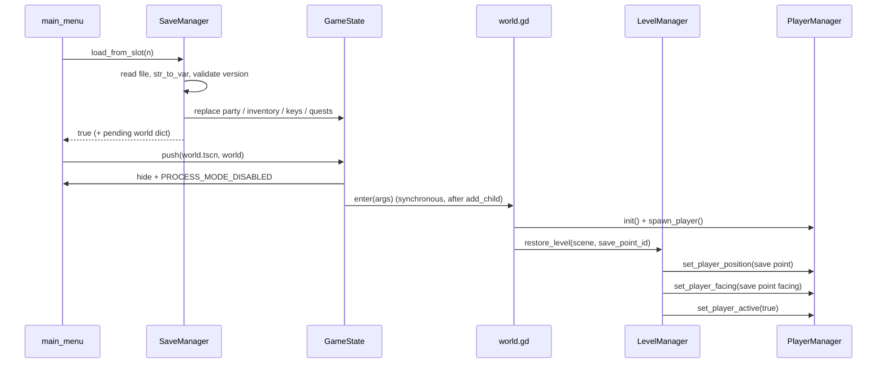

# Save / Load — Implementation Plan

Short plan for persisting overworld progress. Nothing here is implemented yet.

## Goal

Save the game to numbered slots **only at save points placed in the world**, and restore
the player exactly where they saved.

## When you can save

Saving is **checkpoint-based — there is no save-anywhere menu or hotkey.**

- A **save point** is an interactable placed in levels. Interacting with it writes the
  save. This is the *only* way to save.
- The **main menu** can still start a new game and load any existing slot.
- `SaveManager.save_to_slot()` is only ever called by a save point. It still refuses while
  in combat as a defensive check, but there is no other caller.

## What gets saved

| Part | Source | Notes |
| --- | --- | --- |
| Party | `GameState.party.to_dict()` | stats, HP/MP, level/xp, action paths, equipment paths — already exists |
| Inventory | `GameState.inventory.to_dict()` | money + item stacks (by resource path) — already exists |
| Keys | `GameState.keys.get_all()` | all persistence flags/counters — already exists |
| Quests | `QuestManager` | **needs `to_dict`/`from_dict`** (store quest resource paths) |
| World | level scene path + save-point id | player respawns at the save point |

**Not saved:** active combat, transitions, enemies, settings. `GameSettings` already
persists itself; combat is transient.

Because saves happen at a save point, the world is stored as **which level and which save
point**, not the player's arbitrary position — so loading always puts the player back on the
checkpoint (and survives small level edits).

## Slot file shape

```gdscript
{
    "version": 1,
    "saved_at": "2026-10-06T21:00:00",
    "world": {
        "scene": "res://levels/ch1/neuros_home/neuro_room.tscn",
        "save_point_id": "neuro_room_bed",
    },
    "party": <Party.to_dict()>,
    "inventory": <Inventory.to_dict()>,
    "keys": <PersistenceKeys.get_all()>,
    "quests": <QuestManager.to_dict()>,
}
```

Write it with `var_to_str` / `str_to_var` to `user://saves/slot_N.save` (preserves
`int` vs `float`, unlike JSON). JSON is fine too if numbers are coerced on load.

## Prerequisites (small additions)

1. **`QuestManager.to_dict()/from_dict()`** — map entries to `quest.resource_path`; rebuild
   with `load(path)`, skipping missing files. Completion stays derived from keys, so no
   extra state.
2. **`GameState.reset()`** — replace `party`/`inventory`/`keys`/`quests` with fresh
   instances (used by New Game).
3. **`LevelManager.current_level_path()`** — expose the `_current_level` scene path (store
   it in `change_level`).
4. **Restore at a save point** — add `LevelManager.restore_level(scene, save_point_id)` that
   loads the scene and places the player at the matching save point (fall back to a stored
   position if the point is gone).
5. **`Player.get_facing()`** — expose `_last_facing_direction` so the save point can record
   the facing (or just use the save point's own facing).
6. **`world.gd` `enter(args)`** — read an optional
   `{scene, save_point_id}` from `args`; default to `neuro_room` when absent.
7. **Fix `_ensure_party()`** — load with `ResourceLoader.CACHE_MODE_IGNORE` so you get a
   pristine copy from disk. `load()` returns a cached resource that combat has already
   written HP/xp/level into, and `duplicate(true)` copies that dirty state too. See
   `save_load_interference_audit.md` §2.

## New: save points

The lightest option that fits the existing patterns: a Beehave leaf.

- Add **`SaveGame`** (`addons/beehave_additions/save_game.gd`, `ActionLeaf`) that calls
  `SaveManager.save_to_slot(SaveManager.current_slot)` and returns SUCCESS.
- Build a save point like any NPC: `CharacterBody2D`/`Area2D` +
  `BeehaveTree/SequenceComposite` with **`Interacted` → `SaveGame`**.
- Give each point an `@export var save_point_id: String` and register it in a
  `"save_points"` group (same idea as `SpawnPoint`), so loading can find it.
- Place them in levels (the project already has a `SpawnPoint`/`Transition` pattern to
  copy).

Alternatively a standalone `SavePoint` `Area2D` script that connects `Interacted`-style
input directly — same behaviour, less reusable.

## New autoload: `SaveManager` (`autoloads/save_manager.gd`)

```gdscript
const SAVE_VERSION := 1
const SLOTS := 3
const DIR := "user://saves/"

var current_slot: int = -1              # the slot this playthrough saves into

func new_game(slot: int = -1) -> void   # GameState.reset(); bind current_slot
func save_to_slot(slot: int) -> bool    # called by save points; refuse in combat
func load_from_slot(slot: int) -> bool  # restore containers; caller navigates
func has_slot(slot: int) -> bool
func delete_slot(slot: int) -> void
func slot_info(slot: int) -> Dictionary # timestamp / leader name / level, for the menu
func can_save() -> bool                 # not in combat / not mid-transition
```

`save_to_slot` gathers the dict above (including the level path and the active save point)
and writes it. `load_from_slot` reads, checks `version`, calls the `from_dict` methods, and
returns whether it worked. It does **not** change scenes; the caller decides.

`current_slot` is set by New Game (first empty slot, or a chosen one) and by loading. Save
points always write into it.

## Flows

**New game**
`main_menu` → `SaveManager.new_game()` → `GameState.push("res://levels/world.tscn")`
→ default level.

**Save (only at a save point)**
Player interacts with a save point → `Interacted` succeeds → `SaveGame` leaf →
`SaveManager.save_to_slot(current_slot)` → optional "Saved!" feedback.

**Load**
`main_menu` → `SaveManager.load_from_slot(n)` → if `ok`, push `world.tscn` with
`{scene, save_point_id}` → `world.gd` restores that level and places the player
at the save point. Detailed below.

### Loading at startup — detailed sequence

At launch the stack is `[starting_screen, main_menu]`. Loading adds the world on top:
`[starting_screen, main_menu, level_manager]` (`push` hides + disables the menu, it does not
free it). Nothing below the world runs while it is on top.



#### 1. Restore the data (in the menu, before pushing)

`SaveManager.load_from_slot()` reads and **validates before touching `GameState`**, so a
bad file can't leave a half-loaded game. It builds the containers into locals and assigns
them only once everything parsed:

```gdscript
# autoloads/save_manager.gd
var current_slot := -1
var pending_world: Dictionary = {}

func load_from_slot(slot: int) -> bool:
    var path := _slot_path(slot)
    if not FileAccess.file_exists(path):
        return false

    var data: Variant = str_to_var(FileAccess.get_file_as_string(path))
    if not (data is Dictionary) or int(data.get("version", 0)) != SAVE_VERSION:
        return false

    # Parse first...
    var party := Party.from_dict(data.get("party", {}))
    var inventory := Inventory.new()
    inventory.from_dict(data.get("inventory", {}))
    var quests := QuestManager.new()
    quests.from_dict(data.get("quests", {}))

    # ...then commit.
    GameState.party = party
    GameState.inventory = inventory
    GameState.keys.load_from_dict(data.get("keys", {}), true)
    GameState.quests = quests

    current_slot = slot
    pending_world = data.get("world", {})
    return true
```

Notes:

- This is why `Party`/`PartyMember` `from_dict` should read with `data.get(key, default)` —
  a missing field must not throw mid-restore.
- `PartyMember.from_dict` already sets `_initialized = true`, so the restored HP/MP is kept
  instead of being refilled on the first battle.
- Restored members are new `PartyMember` instances (not the cached `.tres`), so a loaded
  game and the editor resources don't share mutable state. Action/equipment *resources* are
  still `load()`ed (shared, but read-only; combat duplicates actions per combatant).

#### 2. Push the world with the destination

```gdscript
# ui/ui_scenes/main_menu.gd
func _on_load_slot(slot: int) -> void:
    if not SaveManager.load_from_slot(slot):
        _show_error("Could not load slot %d" % slot)
        return
    await GameState.push("res://levels/world.tscn", SaveManager.pending_world)
```

`GameState.push` plays the fade, hides/disables the menu, instantiates the world state, and
calls `enter(args)` synchronously. Pass the world dict as `args`; don't stash it in a
global unless you need to.

#### 3. `world.gd` `enter(args)` decides new-game vs load

```gdscript
# levels/world.gd
func enter(args) -> void:
    PlayerManager.init(%PlayerRoot)
    LevelManager.init(%LevelRoot, GameState._transition_root)

    var world: Variant = args
    if world == null:
        _seed_new_game()            # party + starting items ONLY on new game

    PlayerManager.spawn_player()    # reads GameState.party → leader + followers

    if world is Dictionary and world.has("scene"):
        LevelManager.restore_level(String(world["scene"]), String(world.get("save_point_id", "")))
    else:
        LevelManager.change_level(DEFAULT_LEVEL, "default")
```

Ordering constraints that matter here:

- **`PlayerManager.init` then `spawn_player`.** `spawn_player` reads
  `GameState.party.members` to spawn followers, so the party must already be restored
  (it is — step 1 ran before the push).
- **Seeding is new-game-only.** Replace `_ensure_party()`'s "is it empty?" guard with an
  explicit `world == null` check. A legitimately saved game can have an empty inventory;
  the old guard would wrongly re-seed potions into it.
- **Don't seed on load.** `GameState.reset()` runs in `new_game()` before the push, so
  `_seed_new_game()` always starts from fresh containers.

#### 4. `LevelManager.restore_level()` instead of `change_level()`

`change_level` places the player at a `SpawnPoint`; a load needs to place them at a save
point. Split the shared part out so both use it:

```gdscript
# autoloads/level_manager.gd
func restore_level(level_path: String, save_point_id: String) -> void:
    await _swap_level(level_path)                 # fade, free old, instantiate new, add

    var target: Node2D = _find_save_point(save_point_id)   # group "save_points"
    if target == null:
        target = _find_spawn_point("default")              # fallback
    if target != null:
        PlayerManager.set_player_position(target.global_position)
        PlayerManager.set_player_facing(target.get_facing_vector())

    PlayerManager.set_player_active(true)
```

- `_swap_level` is the current `change_level` body minus spawn selection; it must
  `await get_tree().process_frame` after `queue_free()`ing the old level, otherwise
  `get_nodes_in_group("save_points")` can still see the previous level's points.
- The save point is looked up **after** the level is added to the tree (`add_child` runs its
  `_ready`, which registers it in the group).
- If the save point no longer exists (level edited), fall back to `"default"` and then to
  the level origin.

#### Result

After step 4 returns, the world is visible, the player is re-enabled at the save point,
and the restored party/inventory/keys/quests are live. The main menu stays hidden on the
stack; a "return to title" is just `GameState.pop()` back to it.

> In-game load (added later) is the same thing without the push: call
> `SaveManager.load_from_slot(n)`, then `LevelManager.restore_level(scene, id)` on the live
> world state.

## Minimal UI

- `main_menu`: wire **Load Game** to a small slot list instead of starting a new game;
  **New Game** picks a slot (or the first empty one).
- A simple slot list: three rows showing "empty" or `leader name · Lv · timestamp`, with
  Load / Delete.
- **No save UI** — saving is the save point's job. A short "Saved" message is enough.

## Edge cases

- Missing/corrupt file → return `false`, show a message, never crash.
- Version mismatch → refuse (add migrations later).
- Save point missing on load → fall back to the stored scene's `"default"` spawn point.
- Saving during combat → refused (save points also can't be reached then).
- A missing quest/equipment/action path on load → skip that entry, keep going.
- Old saves after adding fields → read with `data.get(key, default)` in `from_dict`.

## Tests

Extend `tests/combat_tests.gd` (or add `tests/save_tests.gd`):

- round-trip each container: `to_dict` → `from_dict` equals the original.
- `SaveManager` write → read a temp slot restores party/inventory/keys/quests.
- `new_game()` clears the containers and binds a slot.
- `SaveGame` leaf writes a slot; `can_save()` is false in combat.
- `world.gd` restores the saved scene/save point when given args.

## Order

1. `QuestManager` serialization + `GameState.reset()`.
2. `SaveManager` (data only) + tests.
3. Save-point object (`SaveGame` leaf) + level/player restore hooks.
4. Menu wiring + slot list.
5. Polish (feedback, delete, optional in-game load).
